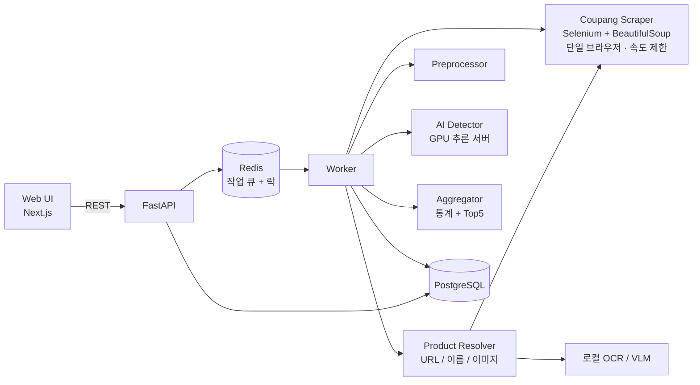

# 리얼별점 (가칭) — 쿠팡 리뷰 AI 작성 탐지 & "사람 리뷰 기준" 별점 재계산 서비스

> **이 문서는 AI 개발 에이전트에게 전달하는 개발 지시서입니다. (v2: 비 API 방식)**
> 쿠팡 데이터(상품 검색, 상품 정보, 리뷰)는 공식 API 없이 **Selenium(브라우저 렌더링·조작) + BeautifulSoup(HTML 파싱)**으로 수집합니다.
> 이미지 인식도 기본은 **로컬 모델**(외부 유료 API 없이)로 구동합니다.
> 이 프로젝트의 모든 기능은 **하나의 홈페이지(웹 서비스)**로 제공됩니다. 홈페이지는 **발표용**이지만 **실제 운영 중인 서비스라는 가정**으로 만듭니다. 홈페이지 작업 규칙은 **섹션 14**에 있습니다.
> 섹션 0의 작업 규칙을 먼저 읽고, 섹션 9의 개발 순서(Phase)대로 진행하세요. 각 Phase는 "완료 기준"을 모두 통과해야 다음으로 넘어갑니다.
> 코드는 **`model/`(AI 탐지 모델 개발 전용)**과 **`service/`(그 외 전부)** 두 폴더로 나뉩니다(섹션 7). 모델 작업의 기준 문서이자 작업 기록은 **`model/MODEL_DEV.md`**입니다.
> **개발 중에 프로젝트 오너(사용자)의 정보나 결정이 필요하면 추측하지 말고 반드시 질문하세요**(섹션 0-9, 14.2).

---

## 0. 에이전트 작업 규칙

1. **Phase 순서를 지킨다.** 각 Phase가 끝나면 완료 기준 체크리스트와 결과(지표, 스크린샷, 샘플 출력)를 보고한다.
2. **TBD 항목(섹션 13)은 임의로 결정하지 않는다.** 꼭 필요하면 기본값을 쓰고 `# TBD-n: 기본값 사용`으로 표시한다.
3. **스크래핑 규칙 (필수)**
   - 사람이 브라우저로 보는 속도에 가깝게 동작한다. 브라우저 1개, 페이지 이동 사이 무작위 대기(기본 3~7초), 분석 1건당 페이지 로드 상한, 일일 상한을 둔다(8장 환경 변수).
   - **차단 우회 기능은 구현하지 않는다.** CAPTCHA 자동 풀이, 프록시/IP 로테이션, 브라우저 지문 위조(stealth 류 패치), 다중 계정, 차단 후 재시도 강도 높이기 모두 금지다.
   - 차단 신호(HTTP 403, "Access Denied" 페이지, CAPTCHA·챌린지 화면, 리뷰 영역이 연속으로 비어 있음)를 감지하면 **작업을 즉시 `blocked` 상태로 중단**한다. 쿨다운(기본 60분) 동안 새 수집을 하지 않고, 사용자에게 알린다.
   - 로그인이 필요한 영역, 장바구니·주문·개인 정보 페이지에는 접근하지 않는다. 공개 상품 페이지, 공개 리뷰, 검색 결과만 다룬다.
   - 수집한 리뷰에서 작성자 식별 정보(닉네임, 프로필 등)는 저장하지 않는다. 필요하면 해시만 저장한다.
   - 같은 데이터를 다시 요청하지 않도록 캐시를 최우선으로 쓴다.
4. **CSS 셀렉터와 DOM 구조는 코드에 하드코딩하지 않는다.** `selectors.yaml`로 분리한다. 쿠팡 화면 구조는 수시로 바뀐다.
5. **비밀값을 하드코딩하지 않는다.** `.env`로 받고 `.env.example`을 유지한다.
6. **모든 모듈에 단위 테스트를 작성한다.** 파서는 저장해 둔 HTML 스냅샷으로 테스트한다. 통계 계산(5.4절)은 고정 예제 테스트를 반드시 포함한다.
7. **모델·데이터 버전 관리:** 모든 예측 결과에 `model_version`을 기록한다.
8. **UI 문구:** "가짜 리뷰" 대신 **"AI 작성 추정"**이라고 쓴다. 결과가 확률적 추정임을 항상 명시한다(섹션 11).
9. **모르면 묻는다 (필수).** 프로젝트 오너만 알 수 있는 정보(서비스명, 브랜드, 발표 일정·환경, 배포처, 법적 문구, 예시 상품 등)나 취향이 갈리는 결정(디자인 시안 선택 등)은 **추측해서 진행하지 않는다.**
   - 질문은 작업을 시작하기 **전에**, 관련 질문을 **한 번에 모아서** 한다. 질문마다 왜 필요한지와 추천 기본값을 함께 적는다.
   - 답을 기다리는 동안에는 그 정보가 필요 없는 작업을 계속한다. 꼭 필요하면 추천 기본값으로 진행하되, 화면·코드에 `TODO(owner): …`로 표시한다.
   - 받은 답은 `docs/decisions.md`에 날짜와 함께 기록하고, 같은 질문을 반복하지 않는다.
   - 홈페이지 관련 필수 질문 목록은 14.2절에 있다.
10. **홈페이지 작업은 섹션 14의 규칙을 따른다.** 섹션 14와 다른 섹션이 충돌하면 화면·문구·디자인은 섹션 14가 우선이고, 데이터·계산·스크래핑 규칙은 해당 섹션이 우선한다.
11. **폴더 분리 (필수).** AI 모델 개발 코드는 `model/`에만, 그 외(홈페이지, API, 스크래핑, 이미지 판독, 집계)는 `service/`에만 둔다(섹션 7). `model/` 작업은 **시작할 때마다 `model/MODEL_DEV.md`를 먼저 읽고, 끝날 때마다 그 문서에 작업·수정 사항과 사용자 요청을 기록한다.**

---

## 1. 프로젝트 개요

### 1.1 한 줄 요약
사용자가 쿠팡 상품을 지정하면, 별점별 리뷰를 표본 수집하고 **AI 작성 여부를 판별**한다. 그 결과로 다음 두 가지를 보여준다.
- **전체 평균 별점**과 **사람이 쓴 리뷰만으로 계산한 평균 별점**의 차이
- **별점별 "사람이 썼을 확률이 가장 높은" 리뷰 Top 5**

### 1.2 해결하려는 문제
- LLM으로 만든 리뷰가 늘면서 별점과 리뷰 내용이 실제 구매자 경험을 반영하지 못할 수 있다.
- 사람은 AI가 쓴 상품 리뷰를 거의 구분하지 못한다(연구 기준 약 50% 수준).

### 1.3 범위
- **v1 포함:** 쿠팡 단일 상품 분석. 입력은 상품 링크, 상품명, 캡처 이미지. 한국어 리뷰. 웹 UI.
- **v1 제외:** 타 쇼핑몰, 리뷰 작성자 계정 분석, 사진·영상 리뷰의 이미지 분석, 체험단·대가성 리뷰 판별. 단, 고지 문구는 플래그로 기록한다.

---

## 2. 사용자 흐름

```
[입력] 상품 링크 | 상품명 텍스트 | 캡처 이미지
   │
   ▼
[상품 식별] ──(후보가 여러 개면)──▶ 후보 카드(썸네일·상품명·가격) 최대 5개 → 사용자 선택
   │
   ▼
[분석 작업 시작] (비동기, 진행률 표시. 수집에 수 분이 걸릴 수 있음)
   ├─ 상품 페이지 로드 → 상품명, 표시 평균, 총 리뷰 수, 별점 분포
   ├─ 리뷰 영역에서 최신순 정렬 + 별점 필터 → 별점별 최대 100개 수집
   ├─ 전처리 (상투 문구 제거, 중복 제거, 체험단 플래그)
   ├─ AI 작성 탐지 (리뷰마다 p_ai, p_human, 라벨)
   └─ 집계 (사람 비율, 보정 평균, 신뢰구간, Top 5)
   │
   ▼
[결과 화면]
   ├─ 전체 평균 vs 사람 리뷰 기준 평균 (차이, 95% 신뢰구간)
   ├─ 별점별 표: 수집 수 / 사람 / AI 추정 / 판단 보류
   ├─ 별점별 사람 리뷰 Top 5 (사람일 확률 표시)
   └─ 주의 문구 + 모델 버전 + 수집 시각
```

---

## 3. 기능 요구사항

| ID | 기능 | 설명 |
|---|---|---|
| F1 | 링크 입력 | 쿠팡 상품 URL(PC/모바일/공유 단축 링크)에서 `productId`(가능하면 `itemId`, `vendorItemId`)를 추출한다. 단축 링크는 브라우저로 열어 최종 URL을 얻는다. |
| F2 | 상품명 입력 | 쿠팡 **검색 결과 페이지**를 Selenium으로 열고 BeautifulSoup으로 파싱해 후보를 제시한다. 광고 상품은 제외하거나 표시한다. |
| F3 | 캡처 이미지 입력 | 로컬 OCR/VLM으로 브랜드·상품명·모델명·규격을 추출한 뒤 F2로 넘긴다. 이미지에 글자가 없으면 시각 정보로 검색어를 만든다. |
| F4 | 리뷰 수집 | 상품 페이지에서 표시 평균, 총 리뷰 수, 별점별 개수(또는 비율)를 파싱한다. 리뷰 영역에서 별점 필터와 최신순 정렬을 적용해 별점별 최대 100개를 페이지를 넘기며 수집한다. |
| F5 | AI 작성 탐지 | 리뷰마다 `p_ai`(보정된 확률)와 라벨 `human` / `ai` / `uncertain`을 출력한다. |
| F6 | 별점 재계산 | 전체 평균과 사람 리뷰 기준 평균, 차이, 신뢰구간을 계산한다(5.4절 공식 **필수 준수**). |
| F7 | Top 5 | 별점별로 `p_human`이 가장 높은 리뷰 5개를 품질 조건(5.5절)에 맞춰 선정한다. |
| F8 | 캐시 | 같은 상품을 TTL(기본 24시간) 안에 다시 요청하면 캐시를 반환한다. 스크래핑 부하를 줄이는 핵심 장치다. |
| F9 | 진행 상태 | 비동기 작업으로 처리하고 단계별 진행률(예: "4점 리뷰 수집 중 60/100")을 제공한다. |
| F10 | 차단 대응 | 차단 신호를 감지하면 즉시 중단하고 `blocked` 상태와 안내 메시지를 반환한다. 캐시된 결과가 있으면 수집 시각과 함께 보여준다. |

---

## 4. 시스템 아키텍처



- **스크래핑 작업은 전역에서 동시에 1개만 실행한다**(Redis 분산 락). 수집 워커와 탐지·집계 워커를 분리해서, 수집 대기 중에도 다른 분석의 탐지·집계는 진행되게 한다.
- Detector는 별도 GPU 프로세스다. Worker가 `POST /predict`로 배치 추론을 요청한다.
- 처리 시간 목표:
  - 수집: 리뷰 500개 기준 **수 분**(페이지 수 × 대기 시간). UI에서 진행률로 보여준다.
  - 수집 이후(전처리, 탐지, 집계): 60초 이내.

---

## 5. 모듈 상세 설계

### 5.1 Product Resolver (상품 식별)

공통 출력:
```json
{
  "status": "resolved | needs_selection | not_found | blocked",
  "candidates": [
    {"product_id": "123456", "item_id": "...", "vendor_item_id": "...",
     "name": "...", "price": 15600, "image_url": "...", "url": "...",
     "is_ad": false, "match_score": 0.92}
  ]
}
```

#### (a) 링크 입력 — `resolver/url.py`
- 지원 형식(실제 샘플로 검증할 것):
  - PC: `https://www.coupang.com/vp/products/{productId}?itemId=...&vendorItemId=...`
  - 모바일: `https://m.coupang.com/vm/products/{productId}...`
  - 공유·단축 링크(예: `link.coupang.com/...`): **Selenium으로 열어 `driver.current_url`을 얻은 뒤** 파싱한다.
- 정규식으로 바로 추출되는 형식은 브라우저를 열지 않는다(부하 절감).
- 테스트: URL 형식별 고정 케이스 10개 이상.

#### (b) 상품명 입력 — `resolver/name_search.py` + `scraper/search_page.py`
- 검색 페이지 URL(예: `https://www.coupang.com/np/search?q={query}`)을 Selenium으로 열고, 상품 목록이 렌더링될 때까지 명시적으로 대기(`WebDriverWait`)한다. 그다음 `page_source`를 BeautifulSoup(lxml)으로 파싱한다.
- 파싱 항목: productId, 상품명, 가격, 썸네일, 상품 URL, 광고 여부, 평점, 리뷰 수. 셀렉터는 `selectors.yaml`에 둔다.
- 첫 페이지만 사용한다(상위 20~40개). 추가 페이지는 열지 않는다.
- 질의 정규화: 공백/특수문자 정리, 용량·수량 표기 통일(`500 mL` → `500ml`), 모델명 패턴 추출(영문+숫자 조합 정규식).
- 후보 점수(`match_score`): 다음을 가중합한다.
  - 정규화한 상품명의 토큰 Jaccard 유사도
  - 모델명 일치 여부(가장 큰 가중치)
  - 브랜드 일치 여부
  - 용량·수량 일치 여부
  - 광고 상품은 감점
- 자동 선택 규칙: `top1 ≥ 0.85` 이고 `top1 − top2 ≥ 0.15`이면 `resolved`, 아니면 `needs_selection`(TBD-4).
- 검색 결과는 질의 기준으로 캐시한다(TTL 24시간).

#### (c) 캡처 이미지 입력 — `resolver/image.py` (기본: 로컬 모델)
1. 전처리: 크기 제한, EXIF 제거. 개인정보가 담길 수 있으므로 **원본은 저장하지 않는다.**
2. **로컬 OCR(1순위):** PaddleOCR 한국어 모델(또는 EasyOCR)로 텍스트 줄과 좌표를 뽑는다. 다음 휴리스틱으로 상품명 후보 줄을 고른다.
   - 글자 크기와 위치(상단, 큰 글씨)
   - 가격 줄(`원`, 숫자+쉼표) 바로 위의 줄
   - 브랜드·모델명 패턴이 포함된 줄
   - 쿠팡 화면 캡처는 UI 고정 문구("로켓배송", "장바구니" 등)를 제거한다.
3. **로컬 VLM(선택, 저신뢰 시 또는 글자가 없는 사진):** 오픈소스 VLM(예: Qwen2.5-VL 계열, TBD-5)으로 아래 JSON을 추출한다.
   ```json
   {"has_text": true, "brand": "...", "product_name": "...", "model_number": "...",
    "spec": "500ml x 2", "category_guess": "...", "is_coupang_screenshot": true,
    "confidence": 0.0}
   ```
   GPU가 부족하면 VLM 없이 OCR만으로 동작해야 한다(기능 저하 모드).
4. 글자가 없는 상품 사진은 VLM 설명으로 검색어를 2~3개 만들어 (b)를 실행한다. 이 경우 항상 `needs_selection`으로 처리한다.
5. 추출 결과로 (b)를 호출한다.

### 5.2 Coupang Scraper (Selenium + BeautifulSoup) — `collectors/coupang/`

#### 구성 파일
| 파일 | 역할 |
|---|---|
| `browser.py` | WebDriver 생성·재사용(Selenium 4 + Selenium Manager), 페이지 로드 타임아웃, 무작위 대기, 페이지 로드 카운터, 종료 처리 |
| `block_detector.py` | 차단 신호 판정(403 문구, Access Denied, CAPTCHA/챌린지 요소, 반복된 빈 결과) → `BlockedError` |
| `search_page.py` | 검색 결과 파싱 (5.1 (b)) |
| `product_page.py` | 상품 메타 파싱: 상품명, 표시 평균, 총 리뷰 수, **별점별 개수 또는 비율** |
| `review_page.py` | 리뷰 영역 조작(정렬 = 최신순, 별점 필터 선택, 페이지 넘김)과 리뷰 파싱 |
| `selectors.yaml` | 모든 CSS 셀렉터·XPath·텍스트 패턴. 버전 표기 포함 |
| `provider.py` | `ReviewProvider` 인터페이스 구현(`CoupangScraperProvider`) |

#### 인터페이스 — `collectors/base.py`
```python
class ReviewProvider(Protocol):
    def get_product_meta(self, product_id: str) -> ProductMeta: ...
    # ProductMeta: name, displayed_avg, total_reviews,
    #              star_counts: dict[int, int] | None, star_ratio: dict[int, float] | None
    def get_reviews(self, product_id: str, star: int, limit: int,
                    sort: Literal["latest", "best"] = "latest") -> list[RawReview]: ...
```
- 구현체: `CoupangScraperProvider`(운영), `FixtureProvider`(저장된 JSON/HTML로 동작, 개발·테스트용 **필수**).

#### 수집 절차 (상품 1개)
1. 상품 페이지 로드 → 명시적 대기 → `page_source`를 BeautifulSoup으로 파싱해 메타를 얻는다.
2. 리뷰 영역으로 스크롤해 렌더링을 기다린다. 리뷰가 지연 로딩되면 해당 요소가 나타날 때까지 대기한다.
3. 정렬을 **최신순**으로 바꾼다.
4. 별점 5→1 순서로, 각 별점마다:
   - 별점 필터를 선택하고 목록이 갱신될 때까지 대기한다.
   - 현재 페이지 리뷰를 BeautifulSoup으로 파싱하고, `review_id`(없으면 내용·날짜 해시)로 중복을 제거한다.
   - 다음 페이지로 이동한다(무작위 대기 포함). `limit`에 도달하거나 마지막 페이지면 종료한다.
5. 매 페이지 로드·조작 후 `block_detector`를 실행한다. 차단이면 즉시 중단한다.
6. 원본 HTML 일부(리뷰 영역)를 디버깅용으로 **최근 N건만** 저장한다. 파서 회귀 테스트 fixture로 활용한다.

- 구현 시점에 실제 화면을 열어 DOM을 확인하고 `selectors.yaml`을 작성한다. 리뷰 목록이 브라우저 안에서 별도 HTML 조각으로 로드되는 구조라면, 같은 브라우저 세션에서 그 조각 URL을 열어 파싱하는 방식도 허용한다. 단, 그 경우에도 속도 제한과 차단 규칙은 똑같이 적용한다.
- 리뷰 하나에 "더보기"(접힌 본문)가 있으면 펼친 뒤 파싱한다. 펼치기 클릭도 대기 규칙을 따른다.

#### `RawReview` 스키마
```json
{"review_id": "...", "product_id": "...", "star": 5, "title": "...", "content": "...",
 "created_at": "2026-10-01", "has_photo": true, "helpful_count": 3,
 "option_name": "...", "author_hash": "sha256...", "raw_html_ref": "..."}
```

#### 수집 정책
- 별점별 `limit = 100`(`SAMPLE_PER_STAR`). 그 별점 리뷰가 100개 미만이면 전부 수집한다.
- 정렬은 **최신순**을 기본으로 하고, 사용한 정렬을 결과에 기록한다.
- **별점별 전체 개수 `N_s`를 반드시 수집한다**(5.4절에 필수). 비율만 보이면 `N_s = round(total_reviews × ratio_s)`로 계산한다.
- 상품 메타와 리뷰는 DB에 캐시한다(TTL 24시간).
- **셀렉터가 깨지면** 파싱 결과의 필수 필드 누락률이 임계값(기본 20%)을 넘을 때 `ParserBrokenError`를 낸다. 이때 작업을 실패 처리하고, 어떤 셀렉터가 실패했는지 로그를 남긴다.

### 5.3 Preprocessor — `model/src/realstar_model/preprocess/`
> 학습과 추론의 전처리를 같게 하기 위해 `model/`에 둔다. `service/`는 `realstar_model.preprocess.clean_review`를 import해서 쓰고 다시 구현하지 않는다. 상세 규칙은 `model/MODEL_DEV.md` 4.4절이 우선한다.

1. **상투 문구를 제거하고 플래그를 기록한다**(지우지 않으면 탐지 모델이 이 문구를 지름길로 학습한다).
   - 예: "본 리뷰는 … 쿠팡캐시 지급 리뷰 이벤트에 참여하기 위해 작성한 것입니다", 체험단·협찬 고지
   - 패턴은 `preprocess/boilerplate_patterns.yaml`로 관리한다.
   - 결과 필드: `is_sponsored`, `is_cash_event`
2. 공백과 줄바꿈을 정규화한다. 이모지와 ㅋㅋ·ㅠㅠ는 **지우지 않는다**(탐지 특징).
3. 상품 안에서 완전 중복과 근접 중복(MinHash, Jaccard ≥ 0.9)에 `dup_group_id`를 부여한다. 삭제하지 않고 기록한다.
4. 탐지 입력은 `title + "\n" + content`를 기본으로 한다(TBD-6).
5. `len_chars < MIN_CHARS`(기본 20)이면 탐지 결과와 관계없이 `uncertain`으로 강제한다.

### 5.4 Aggregator — 별점 재계산 (가장 중요한 계산)

> ⚠️ **표본 평균으로 계산하면 안 된다.** 별점별로 100개씩 똑같이 뽑으면 표본 평균은 항상 3.0이 된다.
> 반드시 **별점별 사람 비율을 표본에서 추정하고, 실제 별점 분포 `N_s`에 가중해** 계산한다.

#### 정의
- `N_s`: 상품의 s점 리뷰 **전체 개수**
- 표본에서 `h_s` = 사람 라벨 수, `a_s` = AI 라벨 수, `u_s` = 판단 보류 수
- `r_s = h_s / (h_s + a_s)`. 판단 보류는 판정된 리뷰와 비율이 같다고 가정하고 제외한다. 이 가정은 화면에 명시한다.

#### 공식
- 전체 평균: `avg_all = Σ s·N_s / Σ N_s`. 쿠팡 표시 평균(`displayed_avg`)과 함께 보여주고, 차이가 0.05를 넘으면 경고한다.
- 사람 리뷰 기준 평균: `avg_human = Σ s·N_s·r_s / Σ N_s·r_s`
- 차이: `diff = avg_human − avg_all`
- 추정 AI 비중: `ai_share = 1 − Σ N_s·r_s / Σ N_s`
- 95% 신뢰구간: 별점별 표본 안에서 리뷰를 복원추출하는 부트스트랩 1,000회
- (Phase 8, 선택) Rogan–Gladen 오류 보정: `r_ai_corr = clip((obs_ai + spec − 1)/(sens + spec − 1), 0, 1)`

#### 예외 처리
- `h_s + a_s = 0`인 별점은 전체 표본 평균 비율로 대체하고 경고한다.
- 모든 별점에서 `h_s = 0`이면 `avg_human`을 계산하지 않고 경고한다.
- 판정된 리뷰가 별점당 30개 미만이면 "표본 부족" 경고를 띄운다.
- 수집이 중간에 차단되어 일부 별점만 수집됐으면 결과를 만들지 않는다. 부분 결과는 디버깅용으로만 저장한다.

#### 고정 검증 예제 (단위 테스트로 그대로 구현)
- `N = {5:1200, 4:400, 3:160, 2:100, 1:140}` (총 2,000개)
- 표본 사람 수 `h = {5:50, 4:30, 3:80, 2:70, 1:60}` (별점당 100개, 판단 보류 0)
- `avg_all = 8420 / 2000 = 4.21`
- 사람 추정 개수 `{5:600, 4:120, 3:128, 2:70, 1:84}` → 합계 1,002
- `avg_human = 4088 / 1002 ≈ 4.080`, `diff ≈ −0.13`, `ai_share = 0.499`
- 잘못된 표본 평균 방식으로 계산하면 전체 3.00, 사람 2.79가 나온다. 이 값이 나오면 테스트 실패로 처리한다.

### 5.5 Top 5 사람 리뷰 선정 — `aggregate/topk.py`
1. 후보: `label == human`이고 `len_chars ≥ TOP_MIN_CHARS`(기본 40)인 리뷰.
2. `p_human` 내림차순으로 정렬한다.
3. 같은 `dup_group_id`에서는 1개만 고른다.
4. 동률(차이 0.01 이내)이면 길이가 길거나 사진이 있는 리뷰를 우선한다.
5. 후보가 5개 미만이면 있는 만큼만 보여주고 부족 안내를 표시한다.
6. 각 리뷰에 `p_human`(%), 작성일, 근거 태그를 표시한다(근거 태그는 Phase 8).

### 5.6 AI Detector — `model/` (요약)
> **이 절은 요약이다. 구현 기준은 `model/MODEL_DEV.md`이며, 충돌하면 MODEL_DEV.md가 우선한다.**


#### 출력 스키마
```json
{"review_id": "...", "p_ai": 0.07, "p_human": 0.93, "label": "human",
 "features": {"stat_curvature": -0.3, "probe_score": 0.1, "spacing_err": 0.12},
 "model_version": "det-ko-review-v1.0"}
```

#### 라벨 결정 (임계값은 검증셋에서 결정)
- `p_ai ≥ T_AI` → `ai`. 사람 리뷰를 AI로 오판하는 비율(FPR) ≤ 2%(TBD-3).
- `p_ai ≤ T_HUMAN` → `human`. AI 리뷰가 사람으로 통과하는 비율 ≤ 5%.
- 그 사이 값이거나 `len_chars < MIN_CHARS`이면 → `uncertain`.

#### 학습 데이터 구축 — `model/src/realstar_model/data_gen/`
- **사람 리뷰(라벨 0):** ChatGPT 공개(2022-11-30) **이전에 작성된** 리뷰만 쓴다.
  - 1순위: 스크래퍼로 수집한 쿠팡 리뷰 중 작성일이 2022-11 이전인 것. **학습용 배치 수집은 서비스 수집과 별도로, 더 낮은 속도와 일일 상한으로 운영한다.** 차단 규칙은 동일하다.
  - 보조: 공개된 네이버 쇼핑 리뷰 20만 건(bab2min/corpus `naver_shopping.txt`).
- **AI 리뷰(라벨 1):** 직접 생성한다.
  - 기본: 로컬 오픈 모델을 vLLM으로 서빙해 생성(한국어 지원 모델 3종 이상. 예: HyperCLOVA X SEED, kanana, Qwen 계열, EXAONE).
  - 권장: 실제 AI 리뷰의 상당수는 상용 LLM으로 작성되므로, 상용 LLM 2~3종도 생성에 포함한다(학습 데이터 생성 단계에만 사용, TBD-7).
  - 변수: 카테고리, 별점 1~5, 길이(한 줄 / 2~3문장 / 장문), 페르소나, 휴머나이즈 지시("사람처럼", "맞춤법 일부 틀리게", "ㅋㅋ 사용")
  - 입력 맥락: 상품명, 상품 설명, 실제 사람 리뷰 2~3개를 참고로 준다.
- **혼합 리뷰(선택):** 사람 리뷰를 LLM이 다듬은 버전(TBD-9).
- **분할 규칙:** 생성 모델 기준과 카테고리 기준으로 학습/검증/테스트를 분리한다.
- 5.3절 전처리를 학습 데이터에도 똑같이 적용한다.

#### 모델 구성 (융합)
| # | 구성 요소 | 구현 | 비고 |
|---|---|---|---|
| ① | 미세조정 분류기 (**메인**) | 한국어 인코더(KcELECTRA·KcBERT 계열 또는 KLUE-RoBERTa-large) + 분류 헤드 | 먼저 이것만으로 베이스라인을 만든다. |
| ② | 내부 표현 linear probe | 한국어 지원 LLM(1.5B~8B)의 레이어별 hidden state 평균 → 로지스틱 회귀 | 적은 샘플로 새 생성 모델에도 일반화한다. |
| ③ | 로그확률 통계 | 같은 LLM으로 Fast-DetectGPT 곡률, 평균 log-prob, log-rank, 셔플 전후 perplexity 비율 | 짧은 글에서는 약하므로 길이 특징을 함께 넣는다. |
| ④ | 한국어 언어 특징 | Kiwi(kiwipiepy) 기반: 띄어쓰기 오류율, 품사 n-gram 다양성, 쉼표 빈도, 맞춤법 오류, ㅋㅋ·ㅠㅠ·이모지·자모 단독 사용, 종결어미 다양성, 문장 길이 분산, AI 상투구 사전, 목록·구조화 서식 | 근거 태그의 원천이다. |
| ⑤ | 메타 분류기 | ①~④ + 길이 → LightGBM 또는 로지스틱 회귀 → Isotonic/Platt 보정 | 최종 `p_ai`. |

- **라이선스 확인(TBD-2):** 상업 서비스라면 모든 모델의 라이선스를 확인한다(예: EXAONE 계열은 비상업).
- ②와 ③은 같은 LLM으로 계산한다. 원문 forward 1회로 ②와 ③(셔플 제외)을 함께 얻고, 셔플 perplexity는 셔플 텍스트 forward가 K회 추가로 필요하다. 배치, bf16을 쓴다.

#### 평가 (잠정 목표, TBD-3)
- 주 지표: **TPR@FPR=1%, 2%** (AUROC는 보조)
- 평가 분할: 같은 분포 / 생성 모델 하나씩 빼고 / 카테고리 하나씩 빼고 / 길이 구간별(<30자, 30~100자, ≥100자)
- 목표: 같은 분포 AUROC ≥ 0.95, 생성 모델 제외 평가에서 ≥100자 구간 TPR@1%FPR ≥ 0.6
- **Shortcut 점검:** 길이·줄바꿈·문장부호만 쓴 로지스틱 회귀 베이스라인을 반드시 함께 보고한다.

### 5.7 API — `apps/api/` (FastAPI)

| Method | Path | 설명 |
|---|---|---|
| POST | `/api/resolve` | `multipart/form-data`: `url` / `query` / `image` 중 하나 → 5.1절 출력 |
| POST | `/api/analyses` | `{"product_id": "...", "force_refresh": false}` → `{"analysis_id", "status": "queued", "queue_position"}` |
| GET | `/api/analyses/{id}` | 상태(`queued/collecting/detecting/aggregating/done/failed/blocked`), 진행률, 결과 |
| GET | `/api/analyses/{id}/events` | (선택) SSE 진행 이벤트 |
| GET | `/api/health` | 헬스 체크(detector, 브라우저 드라이버, 차단 쿨다운 상태 포함) |

#### 분석 결과 스키마
```json
{
  "analysis_id": "an_...",
  "product": {"product_id": "...", "name": "...", "image_url": "...", "url": "..."},
  "platform_stats": {"displayed_avg": 4.2, "total_reviews": 2000,
                     "star_counts": {"5":1200,"4":400,"3":160,"2":100,"1":140}},
  "sampling": {"per_star_limit": 100, "sort": "latest", "collected_at": "...",
               "pages_loaded": 52, "selectors_version": "2026-11-13"},
  "per_star": {"5": {"collected": 100, "human": 50, "ai": 50, "uncertain": 0, "human_ratio": 0.5}},
  "ratings": {"avg_all": 4.21, "avg_human": 4.08, "diff": -0.13,
              "avg_human_ci95": [3.98, 4.17], "ai_share": 0.499},
  "top_human_reviews": {"5": [{"review_id": "...", "text": "...", "p_human": 0.97,
                               "created_at": "...", "has_photo": true, "reason_tags": []}]},
  "flags": {"sponsored_count": 12, "near_duplicate_groups": 3},
  "warnings": [],
  "model": {"version": "det-ko-review-v1.0", "T_AI": 0.8, "T_HUMAN": 0.3}
}
```

### 5.8 Web UI — `apps/web/` (Next.js + TypeScript + Tailwind)
> 화면 구성, 디자인, 문구, 품질 기준은 **섹션 14(홈페이지 작업 규칙)**를 따른다. 아래는 분석 기능 화면의 최소 요구사항이다.

1. **입력 화면:** 탭 3개(링크 / 상품명 / 이미지 업로드·붙여넣기).
2. **후보 선택 화면:** 후보 카드(썸네일·상품명·가격·일치도·광고 표시).
3. **진행 화면:** 대기열 순번, 단계별 진행률(별점별 수집 개수), 예상 소요 시간. 차단되면 안내 메시지와 캐시 결과(있으면)를 보여준다.
4. **결과 화면:**
   - 상단 카드: "전체 평균 ★4.21 → 사람 리뷰 기준 ★4.08 (−0.13)", 신뢰구간, 추정 AI 비중
   - 별점별 누적 막대: 사람 / AI 추정 / 판단 보류
   - 별점 탭별 Top 5 사람 리뷰 카드
   - 하단 고지(섹션 11), 모델 버전, 수집 시각, 표본 수

### 5.9 데이터 저장 — PostgreSQL
- `products(product_id PK, name, image_url, url, displayed_avg, total_reviews, star_counts JSONB, fetched_at)`
- `reviews(review_id PK, product_id FK, star, title, content, clean_text, created_at, has_photo, helpful_count, is_sponsored, is_cash_event, dup_group_id, len_chars, author_hash, fetched_at)`
- `predictions(review_id FK, model_version, p_ai, label, features JSONB, created_at, PK(review_id, model_version))`
- `analyses(analysis_id PK, product_id FK, status, progress, result JSONB, model_version, created_at, finished_at, error)`
- `scrape_log(id PK, started_at, product_id, pages_loaded, outcome[ok/blocked/parser_broken/error], detail)`
- `search_cache(query_norm PK, candidates JSONB, fetched_at)`
- 업로드 이미지는 저장하지 않는다.

---

## 6. 기술 스택

| 영역 | 선택 |
|---|---|
| 언어 | Python 3.11+, TypeScript |
| 스크래핑 | **Selenium 4**(Selenium Manager로 드라이버 관리), Google Chrome, **BeautifulSoup4 + lxml** |
| API | FastAPI, Pydantic v2 |
| 비동기 작업 | Redis + Celery(큐 분리: `scrape` 동시성 1, `detect`/`aggregate`), Redis 분산 락 |
| DB | PostgreSQL 16, SQLAlchemy 2 + Alembic |
| ML | PyTorch, transformers, scikit-learn, LightGBM, kiwipiepy, datasketch |
| 데이터 생성 | vLLM(로컬 생성 모델 서빙) |
| 이미지 | PaddleOCR(한국어), 선택: 로컬 VLM(Qwen2.5-VL 계열 등) |
| 프론트 | Next.js, Tailwind, Recharts |
| 인프라 | Docker Compose. 스크래퍼 워커 이미지에 Chrome 포함 |
| 품질 | pytest, ruff, mypy, pre-commit, GitHub Actions CI |

---

## 7. 디렉터리 구조 (폴더 분리 원칙)

> **AI 탐지 모델 개발 코드는 `model/`에만, 그 밖의 모든 것(웹, API, 워커, 스크래퍼, 이미지 판독, 집계)은 `service/`에만 둔다.**
> 두 폴더는 `model/MODEL_DEV.md` 4.12절의 **계약**(데이터 계약, 추론 API 계약)으로만 연결된다.
> 섹션 5의 모듈 경로는 별도 표기가 없으면 `service/packages/core/` 기준이다. 전처리(5.3)와 탐지(5.6)는 `model/` 소속이다.

```
realstar/
├── README.md                    # 전체 개발 지시서 (이 문서)
├── docs/
│   ├── decisions.md             # 서비스·홈페이지 쪽 결정 기록 (14.2)
│   └── demo-checklist.md
│
├── model/                       # ★ AI 탐지 모델 개발 전용 (Phase 1·2)
│   ├── MODEL_DEV.md             # ★ 모델 개발 마스터 문서: 기술 명세 + 요청·결정·실험·작업 로그
│   ├── pyproject.toml           # 설치 가능한 패키지 realstar_model
│   ├── configs/
│   ├── src/realstar_model/      # preprocess/, data_gen/, datasets/, features/, models/,
│   │                            # fusion/, eval/, inference/
│   ├── scripts/  lexicons/  tests/  docs/  reports/
│   ├── data/                    # (gitignore) raw/coupang/ ← service 스크래퍼가 학습용 JSONL을 여기로 내보냄
│   └── artifacts/               # (gitignore) det-ko-review-v*/
│
└── service/                     # ★ 모델 외 전부 (웹, API, 수집, 이미지 판독, 집계)
    ├── docker-compose.yml
    ├── .env.example
    ├── apps/
    │   ├── api/
    │   ├── worker/              # scrape 큐 워커, detect/aggregate 큐 워커
    │   ├── detector_server/     # realstar_model 패키지를 import해 /predict 제공
    │   └── web/                 # Next.js 홈페이지 (섹션 14)
    ├── packages/core/
    │   ├── resolver/            # url.py, name_search.py, image.py, scoring.py
    │   ├── collectors/
    │   │   ├── base.py
    │   │   ├── fixture_provider.py
    │   │   ├── export_training.py   # 학습용 과거 리뷰를 model/data/raw/coupang/로 내보냄
    │   │   └── coupang/         # browser.py, block_detector.py, search_page.py,
    │   │                        # product_page.py, review_page.py, provider.py, selectors.yaml
    │   ├── vision/              # ocr.py, vlm.py, product_text_heuristics.py (이미지 판독)
    │   └── aggregate/           # stats.py, topk.py
    └── tests/
        ├── fixtures/html/       # 검색·상품·리뷰 HTML 스냅샷
        └── fixtures/json/
```

### 7.1 폴더별 작업 규칙
| 구분 | `model/` | `service/` |
|---|---|---|
| 담당 범위 | 학습 데이터 생성·정제, 특징, 학습, 평가, 추론 패키지 | 홈페이지, API, 워커, 스크래핑, 이미지 판독, 집계, 배포 |
| 기준 문서 | **`model/MODEL_DEV.md`** (README 5.6보다 우선) | 이 README (섹션 14 포함) |
| 기록 의무 | 매 작업마다 MODEL_DEV.md의 요청·결정·실험·작업 로그와 현재 상태를 갱신 | `docs/decisions.md`에 결정 기록 |
| 금지 | service 코드 수정, 웹·스크래퍼·OCR 코드 작성 | 모델 학습 코드 작성, 전처리 재구현(반드시 `realstar_model.preprocess` import) |
| 상대 폴더 연동 | 4.12 계약으로만 | `pip install -e ../model` 후 `realstar_model.inference`만 사용 |
| 작업 지시 단위 | 에이전트에게 "model 폴더 작업"으로 지시 | "service 폴더 작업"으로 지시 |

- 한 번의 작업 지시는 **한 폴더만** 대상으로 한다. 두 폴더에 걸친 변경(계약 변경)은 먼저 MODEL_DEV.md에 결정을 기록하고, 사용자 승인 후 각 폴더에서 따로 진행한다.

---

## 8. 환경 변수 (`.env.example`)

```
# 스크래퍼
SCRAPER_HEADLESS=false              # TBD-10
SCRAPER_DELAY_MIN_SEC=3
SCRAPER_DELAY_MAX_SEC=7
SCRAPER_PAGE_LOAD_TIMEOUT_SEC=20
SCRAPER_MAX_PAGES_PER_ANALYSIS=80
SCRAPER_MAX_PAGES_PER_DAY=1500
SCRAPER_BLOCK_COOLDOWN_MIN=60
SCRAPER_PARSER_FAIL_THRESHOLD=0.2
SAMPLE_PER_STAR=100

# 비전
OCR_ENGINE=paddleocr
VLM_ENABLED=false
VLM_MODEL_PATH=

# 인프라
DATABASE_URL=postgresql+psycopg://...
REDIS_URL=redis://localhost:6379/0
DETECTOR_URL=http://detector:8001

# 탐지/집계
MIN_CHARS=20
TOP_MIN_CHARS=40
CACHE_TTL_HOURS=24
```

---

## 9. 개발 순서 (Phase)

> 원칙: **수집 가능성(Phase 0)과 탐지 성능(Phase 1)이라는 두 가지 큰 불확실성을 먼저 확인**한다. 그다음 링크 입력으로 끝까지 동작하는 흐름을 만들고, 상품명 → 이미지 순으로 입력을 확장한다.
>
> **홈페이지는 별도 트랙(W)으로 병행한다.** 백엔드 Phase와 의존 관계는 아래와 같다.
>
> | 트랙 W 단계 | 시작 가능 시점 | 내용 (섹션 14 참고) |
> |---|---|---|
> | W0 질문 & 기획 | Phase 0과 동시 | 14.2 필수 질문을 오너에게 보내고, 사이트맵과 발표 시나리오 초안을 작성 |
> | W1 디자인 시스템 & 시안 | W0 답변 후 | 디자인 토큰, 핵심 화면 시안 2종 → **오너 승인** |
> | W2 정적 페이지 + 목업 API | W1 승인 후 | 전체 페이지 구현. 분석 화면은 MSW 목업(5.7 스키마)으로 동작 |
> | W3 실제 API 연결 | Phase 5 | 목업을 실제 API로 교체, 오류·차단 상태 연결 |
> | W4 입력 확장 | Phase 6, 7 | 상품명 탭, 이미지 탭 활성화 |
> | W5 발표 준비 & 품질 마감 | 발표 1주 전 | 발표 모드, 예시 분석 저장, 14.9 완료 기준 전체 점검, 리허설 체크리스트 |

### Phase 0 — 골격 + 스크래핑 가능성 검증 (Go/No-Go)
- [ ] 저장소 골격, Docker Compose(Chrome 포함 워커), CI, `.env.example`을 만든다.
- [ ] `browser.py`, `block_detector.py`를 최소 구현한다.
- [ ] 실제 상품 3개로 spike를 진행한다. 아래 항목을 규칙(섹션 0-3)을 지키는 속도로 확인한다.
  - 상품 페이지 메타와 별점 분포 파싱
  - 최신순 정렬과 별점 필터 조작
  - 별점당 100개 수집
- [ ] 각 화면의 HTML 스냅샷을 `tests/fixtures/html/`에 저장하고 `selectors.yaml` 초안을 작성한다.
- [ ] `FixtureProvider`를 만든다.
- **완료 기준:** spike 리포트 제출(성공 여부, 페이지 수, 소요 시간, 차단 발생 여부와 시점). **차단이 반복되면 우회를 시도하지 말고 중단한 뒤 프로젝트 오너에게 보고한다**(대안은 섹션 11 참고).

### Phase 1 — 탐지 모델 데이터셋 & 베이스라인 (오프라인)
> **작업 위치: `model/` 폴더. 세부 단계는 `model/MODEL_DEV.md` 8장 M0~M4를 따르고, 모든 작업을 MODEL_DEV.md에 기록한다.** 아래는 요약이다.
- [ ] 사람 리뷰(2022-11 이전) 데이터셋을 만든다. 네이버 쇼핑 공개 데이터부터 시작하고, 쿠팡 리뷰는 학습용 저속 배치로 추가한다.
- [ ] AI 리뷰 생성 파이프라인을 만든다(최소 2만 건, TBD-7).
- [ ] 전처리를 적용하고 생성 모델·카테고리 기준으로 분할한다.
- [ ] Shortcut 베이스라인과 ① 미세조정 인코더를 학습하고 평가 리포트를 작성한다.
- **완료 기준:** 평가 리포트 제출. 진행/재설계를 결정한다(오너 승인).

### Phase 2 — 융합 모델 & 보정
> **작업 위치: `model/` 폴더(MODEL_DEV.md M5~M8). `detector_server`의 HTTP 서버 부분만 `service/`에서 진행한다.**
- [ ] ②③④ 특징을 구현한다(단위 테스트 포함).
- [ ] ⑤ 메타 분류기, 보정, 임계값 결정 로직을 구현하고, 구성 요소별 제거 실험(ablation)을 한다.
- [ ] `detector_server` `/predict` 배치 API를 만든다.
- **완료 기준:** 베이스라인 대비 주 지표가 개선된다. 리뷰 500개 추론이 60초 이내다.

### Phase 3 — 스크래퍼 완성 + 링크 입력
- [ ] `product_page.py`, `review_page.py`, `provider.py`를 완성한다. 페이지 넘김, 더보기 펼치기, 중복 제거, 캐시, `scrape_log`를 포함한다.
- [ ] `ParserBrokenError`, `BlockedError` 처리와 쿨다운을 구현한다.
- [ ] `resolver/url.py`를 구현한다(단축 링크는 브라우저로 처리).
- [ ] HTML 스냅샷 기반 파서 테스트를 작성한다.
- **완료 기준:** 실제 상품 링크 5개에서 메타, `N_s`, 별점별 리뷰가 DB에 저장된다. 파서 테스트를 통과한다.

### Phase 4 — 집계 + Top 5 + CLI로 끝까지 동작
- [ ] `aggregate/stats.py`를 구현한다(**고정 검증 예제 테스트 통과 필수**).
- [ ] `aggregate/topk.py`를 구현한다.
- [ ] CLI: `python -m realstar analyze --url <쿠팡 링크>` → 결과 JSON.
- **완료 기준:** 링크 하나로 결과 JSON이 생성되고 스키마 검증을 통과한다.

### Phase 5 — API + 비동기 작업 + 웹 UI
- [ ] FastAPI 엔드포인트와 Celery 큐(`scrape` 동시성 1)를 만들고 진행률을 갱신한다.
- [ ] Next.js 화면 4종을 만든다(처음에는 링크 탭만).
- [ ] 캐시, 강제 재분석, 대기열 순번, 차단 안내 화면을 구현한다.
- **완료 기준:** 브라우저에서 링크 입력부터 결과 화면까지 동작한다. 차단 시나리오(모의)에서 안내 화면이 나온다.

### Phase 6 — 상품명 입력
- [ ] `search_page.py` 파서, 질의 정규화, 후보 점수, 검색 캐시를 구현한다.
- [ ] 평가셋: 상품명 50개 → 정답 productId. top-1 / top-5 정확도를 보고한다.
- **완료 기준:** top-5 ≥ 90%(잠정). UI 상품명 탭이 동작한다.

### Phase 7 — 캡처 이미지 입력
- [ ] PaddleOCR 추출과 상품명 줄 휴리스틱을 구현한다. 선택적으로 로컬 VLM을 붙이고, VLM이 없을 때의 저하 모드도 구현한다.
- [ ] 평가셋: 캡처 30개(쿠팡 화면 캡처, 타 사이트 캡처, 실물 사진) → top-5 정확도를 보고한다.
- **완료 기준:** 쿠팡 화면 캡처 기준 top-5 ≥ 90%. UI 이미지 탭(붙여넣기 포함)이 동작한다.

### Phase 8 — 고도화 & 운영
- [ ] Rogan–Gladen 보정 추정치와 Top 5 근거 태그를 추가한다.
- [ ] 셀렉터 상태 모니터링: 매일 고정 상품 1개로 스모크 테스트를 돌리고, 파싱 실패 시 알린다.
- [ ] 모델 모니터링(판단 보류 비율·AI 비중 추이)과 재학습 파이프라인을 만든다.

---

## 10. 테스트 & 품질 기준
- 단위 테스트: URL 파싱 / 검색·상품·리뷰 파서(HTML 스냅샷) / 차단 감지(차단 페이지 스냅샷) / 전처리 정규식 / 통계(고정 예제, 예외) / Top 5 규칙.
- 통합 테스트: `FixtureProvider` + 더미 detector로 E2E. **CI에서는 실제 쿠팡에 접속하지 않는다.**
- 실사이트 스모크 테스트: 수동 실행 또는 하루 1회, 상품 1개만.
- 커버리지 목표: `packages/core` 80% 이상.

---

## 11. 한계, 리스크, 고지 문구

- **스크래핑 관련 리스크 (중요)**
  - 쿠팡 `robots.txt`는 일부 검색엔진 봇 외의 모든 자동 접근을 `Disallow: /`로 막고 있다. 비브라우저 요청에는 403을 반환하는 엣지 보안(Akamai 계열)도 운영한다.
  - 따라서 이 수집 방식은 **사이트 정책과 충돌할 수 있다.** 약관 위반, 접근 차단, 공개 서비스로 운영할 경우의 법적 분쟁(부정경쟁방지법, 저작권법상 데이터베이스 제작자 권리, 개인정보보호법 등) 리스크가 있다. **공개 서비스로 전환하기 전에 법률 검토를 받는다**(TBD-1).
  - 화면 구조가 바뀌면 파서가 깨진다. 셀렉터 분리, 스냅샷 테스트, 일일 스모크 테스트로 대응한다.
  - 수집이 수 분 걸리므로 동시 사용자가 많으면 대기열이 길어진다. 캐시가 핵심이다.
  - **대안 설계(차단이 반복될 경우 검토):** 사용자 본인 브라우저의 확장 프로그램이 사용자가 연 상품 페이지에서 리뷰를 읽어 서버로 보내는 방식. 서버는 탐지와 집계만 담당한다. 서버에서 직접 수집하지 않으므로 서버 부하와 차단 문제가 줄어든다.
- **탐지는 확률적 추정이다.** 오판이 있을 수 있고, 특정 작성자를 비난하는 근거로 쓰면 안 된다.
- **짧은 리뷰는 판별이 어렵다.** 그래서 "판단 보류"로 분리한다.
- **사람이 쓴 대가성·체험단 리뷰는 잡히지 않는다.** 이 서비스는 AI 작성 여부만 판단한다.
- **새로운 LLM이 나오면 성능이 떨어질 수 있다.** 주기적 재학습이 필요하다.
- **결과 화면 고지 문구(기본안):**
  > "AI 작성 여부는 통계 모델로 추정한 값이며 오차가 있을 수 있습니다. '사람 리뷰 기준 별점'은 별점별 표본(최대 100개)에서 추정한 사람 리뷰 비율을 상품 전체 별점 분포에 반영해 계산했습니다. 이 서비스는 쿠팡과 관련이 없습니다."

---

## 12. 용어
- **사람 리뷰 / AI 작성 추정 / 판단 보류:** 라벨 `human` / `ai` / `uncertain`
- **`N_s`:** 상품의 s점 리뷰 전체 개수 / **`r_s`:** 표본에서 추정한 s점 사람 비율
- **TPR@FPR=1%:** 사람 리뷰 오판율을 1%로 묶었을 때 AI 리뷰를 잡아내는 비율
- **차단(blocked):** 사이트가 자동 접근을 거부한 상태. 감지 즉시 중단하고 쿨다운한다.

---

## 13. 미결정 사항 (TBD — 프로젝트 오너가 결정)

| ID | 항목 | 기본값(임시) |
|---|---|---|
| TBD-1 | 운영 범위: 개인·연구용인지 공개 서비스인지, 그리고 법률 검토 | 개인·연구용 |
| TBD-2 | 상업적 이용 여부 → 모델 라이선스 범위 | 연구·프로토타입 |
| TBD-3 | 임계값 정책(허용 FPR)과 성능 목표 | FPR ≤ 2% |
| TBD-4 | 상품 자동 선택 임계값 | 0.85 / 간격 0.15 |
| TBD-5 | 로컬 VLM 모델 선택 | 미사용(OCR만) |
| TBD-6 | 탐지 입력에 리뷰 제목 포함 여부 | 포함 |
| TBD-7 | AI 리뷰 생성 규모, 상용 LLM 사용 여부 | 2만 건, 로컬 모델 |
| TBD-8 | GPU 사양 → probe/통계용 LLM 크기 | 1.5B~3B |
| TBD-9 | 혼합(AI가 다듬은) 리뷰를 별도 클래스로 둘지 | v1은 AI로 통합 |
| TBD-10 | 브라우저 headless 여부 | false(화면 표시) |
| TBD-11 | 홈페이지 관련 결정 전체 | 14.2절 질문 목록으로 오너에게 확인 |

---

## 14. 홈페이지 작업 규칙

### 14.1 목표와 원칙
- 이 홈페이지는 **발표용**이지만 **실제 운영 중인 서비스처럼** 보이고 동작해야 한다. 발표를 보는 사람이 "출시된 서비스"라고 느끼는 수준이 기준이다.
- 원칙은 네 가지다.
  1. **깔끔함:** 여백이 넉넉하고, 강조 색은 하나로 제한하며, 한 화면에 한 가지 메시지만 담는다. 장식용 그래픽과 과한 애니메이션은 쓰지 않는다.
  2. **신뢰감:** 숫자에는 근거(표본 수, 수집 시각, 신뢰구간)를 함께 보여준다. 과장 문구("100% 정확", "가짜 리뷰 박멸")는 쓰지 않는다.
  3. **실서비스 완성도:** 빈 화면, 로딩, 오류, 차단 상태가 모두 디자인되어 있어야 한다. 임시 문구(lorem ipsum)나 깨진 링크, 콘솔 오류가 없어야 한다.
  4. **발표 안정성:** 발표 중 네트워크나 스크래핑이 실패해도 시연이 끊기지 않아야 한다(14.7 발표 모드).

### 14.2 오너에게 반드시 물어볼 것 (W0에서 한 번에 질문)
아래 항목은 **추측해서 정하지 않는다.** W0 단계에서 한 번에 묶어 질문한다. 각 질문에는 이유와 추천 기본값을 붙이고, 답은 `docs/decisions.md`에 기록한다.

| # | 질문 | 왜 필요한가 | 추천 기본값(답이 없을 때 임시) |
|---|---|---|---|
| Q1 | 서비스 이름과 한 줄 소개 문구 | 로고, 제목, 메타태그 전체에 쓰임 | "리얼별점" / "AI가 쓴 리뷰를 걸러낸 진짜 별점" |
| Q2 | 로고 유무, 브랜드 색상 선호 | 디자인 토큰 결정 | 텍스트 로고, 남색 계열 단일 강조색 |
| Q3 | 발표 일시, 발표 시간(분), 발표 장소의 화면 해상도·비율 | 레이아웃 기준 해상도, 시연 시나리오 길이 | 1920×1080, 시연 3분 |
| Q4 | 발표장에서 인터넷 사용 가능 여부, 발표에 쓸 기기(노트북 OS·브라우저) | 발표 모드 필요 수준 | 인터넷 불안정 가정 → 발표 모드 필수 |
| Q5 | 시연에 쓸 예시 상품 3~5개(링크) | 미리 분석·저장해 둘 대상 | 카테고리가 다른 인기 상품 3개를 에이전트가 후보로 제안 → 오너 선택 |
| Q6 | 배포 위치(도메인 유무, Vercel 등) 또는 로컬 시연만 하는지 | 배포 설정, 메타 URL | 로컬 + 선택적 Vercel 미리보기 |
| Q7 | 팀/제작자 소개 노출 여부와 내용(이름, 소속, 연락처 이메일) | 소개 페이지, 푸터 | 노출 안 함, 푸터에 문의 이메일 자리만 |
| Q8 | 모델 성능 지표(평가 결과)를 사이트에 공개할지 | "작동 원리" 페이지 구성 | 공개(TPR@1%FPR, 표본 수, 평가 기준일) |
| Q9 | 다크 모드 필요 여부 | 디자인 범위 | 라이트 모드만 |
| Q10 | 이용약관·개인정보처리방침 문구를 직접 줄지, 초안을 작성할지 | 실서비스 가정에 필요한 페이지 | 에이전트가 초안 작성 → 오너 검토(법률 자문 아님 명시) |
| Q11 | 방문자 분석 도구(GA 등) 사용 여부 | 쿠키 고지, 개인정보 문구 | 사용 안 함 |
| Q12 | 디자인 참고 사이트나 피하고 싶은 스타일 | 시안 방향 | 없음 → 시안 2종 제시 |

- 위 목록 외에도 **오너만 답할 수 있는 정보가 필요해지면 그때마다 질문한다.**
- **질문 없이 진행하면 안 되는 경우:** 오너의 이름·연락처·소속 등 개인정보 노출, 외부 공개 배포, 법적 문구 확정, 발표 시나리오 확정.

### 14.3 사이트맵 (실서비스 가정)

| 경로 | 페이지 | 핵심 내용 |
|---|---|---|
| `/` | 홈(랜딩) | 히어로: 서비스 한 줄 소개 + **바로 입력창**(링크/상품명/이미지 탭). 아래로 "어떻게 작동하나요" 3단계, 예시 결과 미리보기 카드, 신뢰 요소(표본·방법론 요약), FAQ 요약, CTA |
| `/analyze` | 분석 시작 | 입력 탭 3종, 입력 예시, 이미지 드래그앤드롭·붙여넣기 |
| `/analyze/select` | 상품 선택 | 후보 카드(썸네일·상품명·가격·일치도·광고 표시) |
| `/analyses/[id]` | 진행 → 결과 | 진행 단계 표시 → 완료 시 같은 주소에서 결과 리포트로 전환 |
| `/how-it-works` | 작동 원리 | 수집 → 탐지 → 재계산 과정을 다이어그램으로 설명, 탐지 모델 개요, 별점 재계산 공식(쉬운 말 + 수식 접기), 한계 |
| `/faq` | 자주 묻는 질문 | 정확도, 판단 보류 뜻, 체험단 리뷰, 데이터 보관 등 |
| `/terms`, `/privacy` | 이용약관, 개인정보처리방침 | 초안(Q10) |
| `/about` | 소개(선택, Q7) | 프로젝트 배경, 팀 |
| `404`, `500` | 오류 페이지 | 홈으로 돌아가기, 분석 다시 시작 |

- 공통 레이아웃: 상단 내비게이션(로고 / 작동 원리 / FAQ / "분석하기" 버튼), 푸터(서비스명, "쿠팡과 무관한 독립 서비스" 문구, 약관·개인정보 링크, 문의).

### 14.4 결과 리포트 화면 (발표의 핵심 화면)
위에서 아래 순서로 배치한다.
1. **상품 헤더:** 썸네일, 상품명, 쿠팡 원문 링크(새 탭), 수집 시각, "저장된 결과" 배지(캐시인 경우)
2. **핵심 비교 카드(가장 크게):** `전체 평균 ★4.21` → `사람 리뷰 기준 ★4.08`, 차이 `−0.13`, 95% 신뢰구간, 추정 AI 리뷰 비중. 차이의 방향에 따라 문장을 자동 생성한다(예: "AI 추정 리뷰를 제외하면 별점이 0.13점 낮아져요").
3. **별점별 구성 차트:** 5★~1★ 가로 누적 막대(사람 / AI 추정 / 판단 보류). 막대 옆에 숫자를 직접 표기하고, 범례는 차트 위에 둔다.
4. **사람 리뷰 Top 5:** 별점 탭(5★~1★). 카드마다 본문(긴 글은 접기), "사람일 확률 97%", 작성일, 사진 여부, 근거 태그.
5. **해석 가이드 & 고지:** 판단 보류의 뜻, 표본 방식, 섹션 11 고지 문구, 모델 버전. 접이식 "자세히 보기".
6. **공유/저장:** 결과 링크 복사. (선택) PNG 저장 또는 인쇄용 레이아웃.

### 14.5 디자인 시스템
- **구현 도구:** Next.js(App Router) + TypeScript + Tailwind CSS + shadcn/ui(필요한 컴포넌트만) + lucide 아이콘 + Recharts.
- **글꼴:** Pretendard(한글·영문 통일). 숫자에는 tabular-nums를 적용한다.
- **색상 토큰** (`tailwind.config`와 CSS 변수로 정의하고, 하드코딩 색상은 금지):
  - 중립: 배경(흰색/아주 옅은 회색), 표면, 테두리, 본문 텍스트, 보조 텍스트
  - 강조(primary) 1개: 버튼, 링크, 핵심 숫자
  - 의미 색: 사람(human), AI 추정(ai), 판단 보류(uncertain), 경고, 오류. 사람과 AI는 색약 사용자도 구분할 수 있는 조합으로 하고, 색만으로 구분하지 않는다(패턴이나 라벨 병기).
  - **쿠팡 브랜드 색과 로고는 쓰지 않는다**(제휴 서비스로 오해받지 않기 위함).
- **타이포 스케일:** Display / H1 / H2 / H3 / Body / Caption의 6단계만 쓴다. 발표 화면을 고려해 본문은 16px 이상, 핵심 숫자는 48px 이상으로 한다.
- **간격:** 8px 그리드. 섹션 사이 간격은 데스크톱 96px 이상.
- **모서리·그림자:** 모서리 12~16px 통일, 그림자는 1단계만(카드). 테두리 위주로 구분한다.
- **모션:** 150~250ms 페이드·슬라이드만 쓴다. 숫자 카운트업은 핵심 비교 카드에만 한 번 허용한다. `prefers-reduced-motion`을 존중한다.
- **이미지:** 저작권이 불분명한 이미지, 실존 인물 사진, 쿠팡 화면 캡처를 마케팅 이미지로 쓰지 않는다. 일러스트가 필요하면 단순한 자체 제작 SVG를 쓴다. 상품 썸네일은 분석 결과 화면에서만 표시한다.
- W1에서 **토큰과 핵심 화면 2개(홈, 결과 리포트)의 시안을 2가지 방향으로** 만들어 스크린샷으로 제시하고, 오너 승인 후 구현한다.

### 14.6 문구(카피) 규칙
- 한국어 해요체로 짧게 쓴다. 한 문장은 40자 내외로 한다.
- 용어를 통일한다: "AI 작성 추정", "사람 리뷰", "판단 보류", "사람 리뷰 기준 별점". "가짜", "조작", "사기" 같은 단정적 표현은 금지다.
- 숫자 표기: 별점은 소수 둘째 자리(★4.21), 비율은 소수 첫째 자리(49.9%), 개수는 천 단위 쉼표를 쓴다.
- 확률 결과에는 항상 근거를 붙인다(예: "별점별 최대 100개 표본 기준").
- 오류 문구는 원인과 다음 행동을 함께 안내한다(예: "지금은 쿠팡에서 정보를 가져올 수 없어요. 잠시 후 다시 시도하거나 저장된 결과를 확인해 주세요.").

### 14.7 상태 디자인 & 발표 모드
- **모든 데이터 화면에 5가지 상태를 구현한다:** 로딩(스켈레톤), 빈 결과, 오류, 차단(`blocked`), 부분 결과/표본 부족 경고.
- **진행 화면:** 단계 표시(상품 확인 → 리뷰 수집 → AI 판별 → 결과 계산), 별점별 수집 개수, 대기열 순번, 예상 시간. 진행 업데이트는 `aria-live`로 알린다.
- **발표 모드(`NEXT_PUBLIC_DEMO_MODE=true`):**
  - 미리 **실제로 분석해 저장한** 예시 상품 결과(Q5)를 사용한다. 네트워크와 스크래핑 없이 전체 흐름(입력 → 선택 → 진행 → 결과)을 시연할 수 있어야 한다.
  - 진행 화면은 저장된 실제 분석 로그의 단계를 짧게(10~15초) 재생한다.
  - 결과 화면에는 "저장된 분석 결과 · 수집 시각"을 표시한다. 저장된 데이터를 실시간 결과로 꾸미지 않는다.
  - 발표 모드에서 예시 외 상품을 입력하면 "발표 모드에서는 예시 상품만 분석할 수 있어요"라고 안내한다.
- **발표 리허설 체크리스트**를 `docs/demo-checklist.md`로 만든다. 해상도, 브라우저 확대 비율, 오프라인 동작, 시연 순서, 예비 화면(스크린샷 PDF)을 포함한다.

### 14.8 기술·품질 규칙
- **API 연동:** 5.7 스키마로 TypeScript 타입과 zod 검증을 만든다. 가능하면 OpenAPI에서 자동 생성한다. 백엔드가 준비되기 전에는 **MSW 목업**으로 개발한다. 목업 데이터도 실제와 같은 스키마와 현실적인 값을 쓴다.
- **데이터 요청:** TanStack Query로 분석 상태를 폴링한다(2~3초 간격, 완료·실패 시 중단). 가능하면 SSE를 쓴다.
- **반응형:** 기준은 데스크톱 1920×1080(발표)과 1440×900이다. 태블릿 768, 모바일 375에서도 깨지지 않아야 한다.
- **접근성:** WCAG 2.1 AA 대비율, 키보드만으로 전체 흐름 가능, 포커스 표시, 이미지 대체 텍스트, 차트에 표 형태 대체 정보 제공.
- **성능:** Lighthouse(데스크톱) 성능·접근성·권장사항·SEO 각 90점 이상, LCP 2.5초 이내. 이미지는 `next/image`로 최적화한다.
- **실서비스 요소:** 페이지별 title·description, OG 이미지, 파비콘, `robots.txt`·`sitemap.xml`(자기 사이트용), 404/500 페이지, 환경 변수로 API 주소 관리.
- **보안·개인정보:** 업로드 이미지는 저장하지 않음을 화면에 안내한다. 리뷰 작성자 닉네임을 표시하지 않는다. 외부 스크립트는 최소화한다(Q11).
- **코드 품질:** ESLint, Prettier, TypeScript strict. 컴포넌트는 `components/ui`(기본)와 `components/features`(기능)로 나눈다. 주요 컴포넌트는 Storybook 또는 테스트 페이지에서 상태별로 확인할 수 있게 한다.
- **테스트:** Playwright E2E로 링크 입력 → 결과, 상품명 → 후보 선택 → 결과, 이미지 업로드 → 결과, 차단·오류 상태, 발표 모드 전체 흐름을 검증한다.

### 14.9 홈페이지 완료 기준 (W5 최종 점검)
- [ ] 14.3의 모든 페이지가 구현되었고, 임시 문구·깨진 링크·콘솔 오류가 없다.
- [ ] 결과 리포트가 14.4 구성을 따르고, 고정 검증 예제(5.4)를 목업으로 넣었을 때 숫자가 정확히 표시된다.
- [ ] 5가지 상태(14.7)가 모든 데이터 화면에 있다.
- [ ] 발표 모드로 오프라인에서 전체 시연이 3분 안에 끊김 없이 된다.
- [ ] Lighthouse 기준(14.8)과 접근성 기준을 통과했다.
- [ ] 1920×1080, 1440×900, 768, 375 해상도의 전 페이지 스크린샷을 제출했다.
- [ ] 14.2 질문의 답이 `docs/decisions.md`에 기록되어 있고, 남은 `TODO(owner)`가 0개다(남았으면 목록으로 오너에게 질문한다).
- [ ] 각 W 단계가 끝날 때 스크린샷과 함께 오너에게 보고하고 피드백을 반영했다.